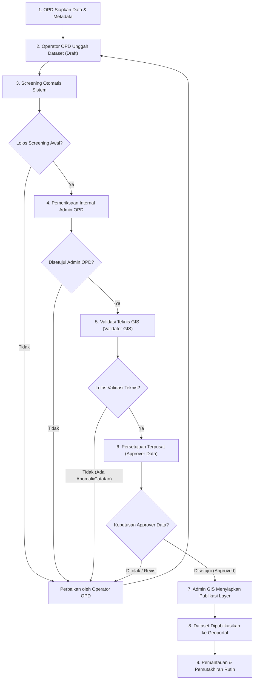

# SIG MINSEL --- Fase 2: Role dan Kewenangan Pengguna

**Nama sistem:** Sistem Informasi Geografis Kabupaten Minahasa Selatan  
**Nama singkat:** GeoMinsel  
**Jenis aplikasi:** Geoportal dan sistem pengelolaan data geospasial mandiri (*standalone*)  
**Dokumen:** Spesifikasi Fase 2 --- Role dan Kewenangan Pengguna  
**Status:** Rancangan final fase berdasarkan keputusan pengguna  
**Versi dokumen:** 1.0  

---

## 1. Pendahuluan & Prinsip Desain

Fase 2 menetapkan rancangan pengguna, role, permission, kewenangan organisasi (OPD), pembatasan akses data, dan alur tanggung jawab dalam **GeoMinsel**.

### Pemisahan Kewenangan yang Tegas:
1. **Pengelolaan Aplikasi & Infrastruktur**: Diskominfo / Superadmin.
2. **Pengelolaan Teknis GIS & Katalog**: Admin GIS.
3. **Penginputan & Pemutakhiran Data Sektoral**: OPD Produsen Data (Admin OPD & Operator OPD).
4. **Validasi Teknis Geometri/CRS/Atribut**: Validator GIS.
5. **Persetujuan Dataset Terpusat**: Approver Data.
6. **Publikasi Layer ke Geoportal**: Admin GIS (hanya setelah status persetujuan sah).
7. **Akses Publik**: Masyarakat umum terhadap dataset yang telah dinyatakan terbuka (*open data*).

---

## 2. Delapan (8) Role Utama GeoMinsel

| No | Role | Lingkup Akses Utama | Tujuan & Batasan |
|---|---|---|---|
| 1 | **Superadmin** | Seluruh sistem | Kelola konfigurasi, akun tingkat sistem, master OPD, role/permission, audit log, dan **Modul Data Dasar Geospasial (Upload SHP Batas Administrasi)**. Tidak otomatis menjadi pemilik data sektoral. |
| 2 | **Admin GIS** | Operasional teknis geospasial & publikasi | Kelola katalog dataset/layer, styling/simbologi, metadata, pengarsipan teknis, dan publikasi layer yang telah disetujui Approver Data. Tidak boleh melewati persetujuan pusat. |
| 3 | **Admin OPD** | Organisasi/OPD yang ditugaskan | Kelola akun Operator pada OPD sendiri, pantau status unggahan/validasi, ajukan dataset baru/pembaruan ke pusat. Tidak dapat menyetujui dataset secara terpusat atau memublikasikan langsung. |
| 4 | **Operator OPD** | Dataset sektoral yang ditugaskan | Unggah dataset, input atribut, isi metadata, perbaiki dataset yang dikembalikan validator. Tidak dapat menyetujui pekerjaannya sendiri (*no self-approval*). |
| 5 | **Validator GIS** | Validasi teknis sesuai penugasan | Uji kelayakan teknis: validitas geometri, kesesuaian CRS (EPSG:4326), kewajaran koordinat, duplikasi, dan kelengkapan atribut. Menetapkan status lolos teknis atau mengembalikan dengan catatan koreksi. |
| 6 | **Approver Data** | Persetujuan terpusat (*Central Approval*) | Menilai hasil validasi teknis dan kesesuaian kebijakan daerah. Menyetujui, menolak, atau mengembalikan dataset. Gerbang utama sebelum publikasi. |
| 7 | **Pimpinan / Executive Viewer** | Pemantauan & Laporan Eksekutif | Akses *read-only* terhadap dashboard strategis, peta tematik pimpinan, indikator capaian, dan rekapitulasi progres pemutakhiran data lintas OPD. |
| 8 | **Publik** | Informasi & Geoportal Terbuka | Akses masyarakat umum tanpa login: jelajah peta interaktif, pencarian fasilitas/lokasi, unduh dataset terbuka, dan lihat metadata publik. |

---

## 3. Alur Kerja (Workflow) Dataset: Persetujuan Terpusat

### 12 Status Dataset:
`draft` &rarr; `submitted` &rarr; `screening` &rarr; `opd_review` &rarr; `technical_validation` &rarr; `revision_required` &rarr; `pending_approval` &rarr; `approved` &rarr; `rejected` &rarr; `publishing` &rarr; `published` &rarr; `archived`.

---

## 4. Master 28 Kategori Geospasial GeoMinsel

1. **Wilayah Administrasi** (Polygon) &mdash; Setda / Bagian Pemerintahan
2. **Pemerintahan** (Point/Polygon) &mdash; Setda & Diskominfo
3. **Kependudukan** (Tabel/Polygon) &mdash; Disdukcapil
4. **Pendidikan** (Point/Polygon) &mdash; Dinas Pendidikan
5. **Kesehatan** (Point/Polygon) &mdash; Dinas Kesehatan
6. **Pekerjaan Umum dan Infrastruktur** (Point/Line/Polygon) &mdash; Dinas PUPR
7. **Perhubungan dan Transportasi** (Point/Line) &mdash; Dinas Perhubungan
8. **Pertanian dan Tanaman Pangan** (Point/Polygon) &mdash; Dinas Pertanian
9. **Perkebunan** (Point/Polygon) &mdash; Dinas Perkebunan / Pertanian
10. **Peternakan** (Point/Polygon) &mdash; Dinas Pertanian & Peternakan
11. **Perikanan dan Kelautan** (Point/Line/Polygon) &mdash; Dinas Perikanan
12. **Pariwisata dan Kebudayaan** (Point/Line/Polygon) &mdash; Dinas Pariwisata
13. **Lingkungan Hidup dan Kehutanan** (Point/Line/Polygon/Raster) &mdash; Dinas Lingkungan Hidup
14. **Kebencanaan** (Point/Line/Polygon) &mdash; BPBD
15. **Perumahan dan Permukiman** (Point/Polygon) &mdash; Dinas Perkim
16. **Perdagangan dan Perindustrian** (Point/Polygon) &mdash; Dinas Perdagangan & Perindustrian
17. **Koperasi dan UMKM** (Point) &mdash; Dinas Koperasi & UKM
18. **Sosial dan Kesejahteraan** (Point/Polygon) &mdash; Dinas Sosial
19. **Ketenagakerjaan dan Transmigrasi** (Point/Polygon) &mdash; Dinas Tenaga Kerja
20. **Pertanahan dan Penataan Ruang** (Polygon/Line) &mdash; Dinas PUPR (Tata Ruang)
21. **Energi dan Sumber Daya Mineral** (Point/Line/Polygon) &mdash; Dinas ESDM / Terkait
22. **Komunikasi dan Informatika** (Point/Line) &mdash; Diskominfo
23. **Keagamaan** (Point) &mdash; Bagian Kesra / Kemenag
24. **Olahraga dan Kepemudaan** (Point/Polygon) &mdash; Dispora
25. **Perlindungan Perempuan dan Anak** (Point/Polygon) &mdash; DP3A
26. **Keamanan dan Ketertiban** (Point) &mdash; Satpol PP dan Damkar
27. **Data Geografis Dasar** (Raster/Line/Polygon) &mdash; Bappeda / Diskominfo
28. **Investasi dan Potensi Daerah** (Point/Polygon) &mdash; DPMPTSP & Bappeda

---

## 5. Modul Khusus Superadmin: Manajemen Data Dasar Geospasial

Superadmin mengelola layer acuan resmi:
- **Menu**: `Settings -> Data Dasar Geospasial`
- **Fitur Unggah SHP (ZIP)**:
  * Batas Kabupaten (`batas_kabupaten.shp`)
  * Batas Kecamatan (`batas_kecamatan.shp`)
  * Batas Desa / Kelurahan (`batas_desa_kelurahan.shp`)
- **Pemeriksaan Komponen Wajib**: `.shp`, `.shx`, `.dbf`, `.prj`.
- **Validasi Topologi & CRS**: Validasi geometri tertutup, non-self-intersecting, CRS WGS84 / UTM.
- **Hierarki Kode Kemendagri**: Verifikasi hubungan kode wilayah (`71.05` &rarr; `71.05.xx` &rarr; `71.05.xx.xxxx`).
- **Pengelolaan Versi**: Menyimpan riwayat versi lama dan mengarsipkan data digantikan.
- **Aturan Batasan OPD**: OPD dilarang mengubah batas administrasi dasar; seluruh data OPD wajib menginduk pada data dasar resmi ini.

